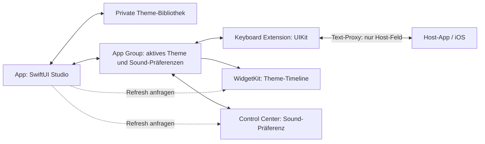

# Architektur und Datenflüsse

AirKeyboard hat eine SwiftUI-App, eine UIKit-Tastaturerweiterung und eine WidgetKit-Erweiterung mit Control-Center-Funktion. Kein Backend und keine Drittanbieter-Laufzeitpakete. Das Diagramm beschreibt die implementierten Wege; funktionierende App-Group-Kommunikation auf Hardware ist noch offen.

WidgetKit/Control Center tauschen keine Tastatureingaben mit der Keyboard Extension aus. Der gemeinsame Speicher vermittelt Einstellungen; es gibt keinen direkten Tastatur-zu-Widget-Datenkanal.

## Lesen, Schreiben und Grenzen

1. **Studio und Bibliothek:** `AppModel` verwaltet den Editor. Themes und Favoriten liegen im privaten Application-Support-Verzeichnis. Import/Export nutzt validiertes JSON. Anwenden überträgt einen aktiven Snapshot; Speichern der Bibliothek und Anwenden sind getrennte Vorgänge und können getrennt fehlschlagen.
2. **App Group:** `SharedStore` liest/schreibt Theme- und Sound-Einstellungen mit Dateikoordination, atomarem JSON und vorheriger gültiger Sicherung. Keine Eingaben oder komplette Theme-Bibliothek werden geteilt. Container und Entitlements müssen tatsächlich verfügbar sein.
3. **UIKit-Tastatur:** Liest Einstellungen beim Erscheinen und periodisch im sichtbaren Zustand; keine Dateilesung pro Tastendruck. Änderungen gemeinsamer Einstellungen setzen Full Access voraus. Tasten verwenden den öffentlichen Text-Proxy des Host-Felds; Kontext dient kurzzeitig der Großschreibung und wird nicht gespeichert.
4. **Widget und Control:** Das Widget liest den Snapshot; der Control-Intent ändert nur die Sound-Präferenz und fordert Refreshes an. Auch die App fordert nach Änderungen Aktualisierungen an. iOS entscheidet über die tatsächliche Aktualisierung; es gibt keine garantierte sofortige Synchronisierung.
5. **Lokaler Modus:** Ohne autorisierte App Group werden App-/Tastaturdaten getrennt gespeichert. Die Tastatur bietet integrierte lokale Designs. Widget/Control melden fehlende Freigabe; eigene Studio-Designs werden dann nicht über Sandboxes hinweg synchronisiert.

## Verifikation und weitere Quellen

Simulator-Build und Core-/App-UI-Tests sind belegt; signierte Entitlements, App Group, Host-Tippen, Audio und Accessibility auf Hardware bleiben [offen](Device-Verification.md). Es gibt keinen Netzwerkpfad für Tastatureingaben im iOS-Quellcode.

Details: [ausführliche Architektur](../Documentation/ARCHITECTURE.md), [Datenschutz](../Documentation/PRIVACY.md), [Sicherheitsmodell](../SECURITY.md). Quellcode: [SharedStore](../Shared/Platform/SharedStore.swift), [KeyboardViewController](../Keyboard/KeyboardViewController.swift), [ThemeWidget](../Widgets/ThemeWidget.swift), [SoundControl](../Widgets/SoundControl.swift).
