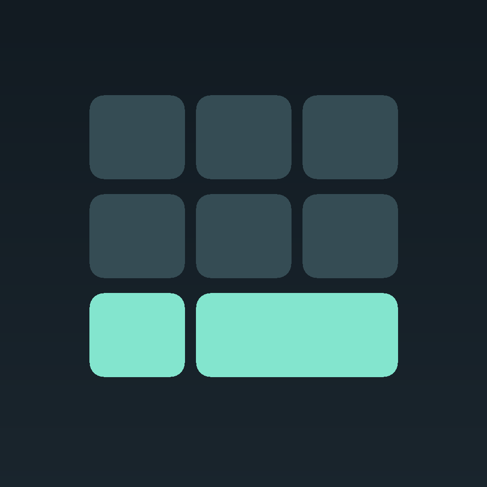
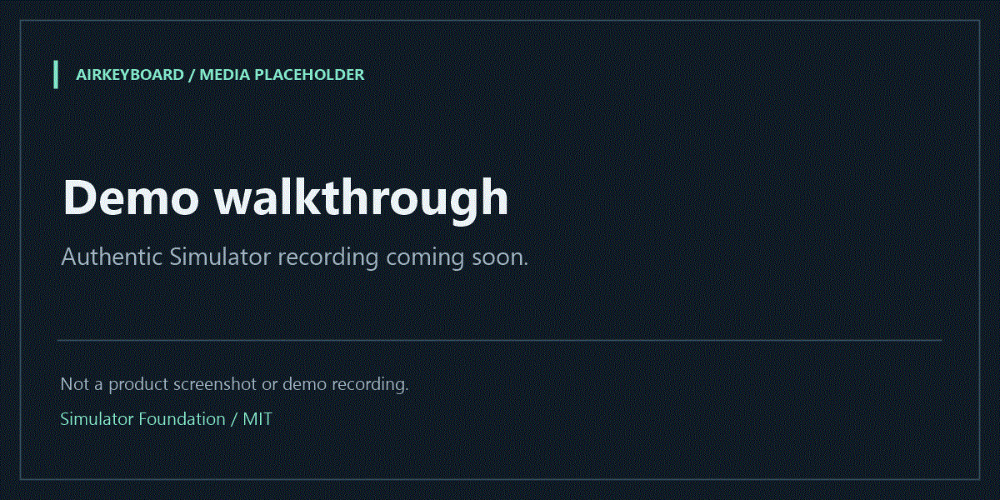
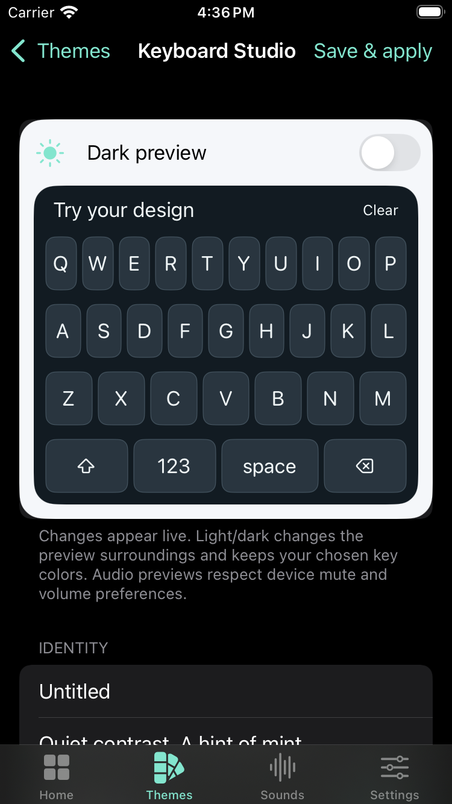

<div align="center">
  
  <h1>AirKeyboard</h1>
  <p>Kostenlose, native iOS-Tastatur mit Theme-Studio, Sound-Packs und WidgetKit – Open Source, ohne Abos, ohne Cloud.</p>
  <p>
    <a href="https://github.com/m4z8p6fy9m-coder/airkeyboard-ios/actions/workflows/ci.yml"></a>
    <a href="LICENSE"></a>
    <a href="https://github.com/m4z8p6fy9m-coder/airkeyboard-ios/commits/main/"></a>
  </p>
  <p><a href="#quick-start">Quick Start</a> · <a href="#verification">Verifikation</a> · <a href="CHANGELOG.md">Changelog</a> · <a href="CONTRIBUTING.md">Mitmachen</a></p>
</div>

> **v0.1.0 – Simulator Foundation (Release-Entwurf)**  
> **Simulator-only. Device verification pending.** Es gibt noch keine installierbare iPhone-IPA. Der CI-Badge zeigt den Workflow auf `main`; konkrete Nachweise stehen in der Verifikationstabelle.

## 📸 Demo

<p align="center">
  
  <br />
  
</p>

Die vorgesehenen Aufnahmen zeigen später das Bearbeiten eines Themes und die interaktive Tastaturvorschau; beide Dateien sind derzeit **klar beschriftete Platzhalter**, keine Produktaufnahmen. [Asset-Status und Austausch](assets/README.md).

## ✨ Features

| Feature | Beschreibung |
| --- | --- |
| Native Tastatur | UIKit-Tastatur mit Texteingabe, Shift/Caps Lock, Zahlen, Symbolen, Löschen und Globe-Wechsel; nur in von iOS unterstützten Eingabefeldern. |
| Theme-Studio | Sechs eigene Themes; Farben, Form, Abstände, Schrift und QWERTY/QWERTZ bearbeiten, Designs duplizieren und favorisieren. Die direkt gebundene Vorschau hat einen separaten Hell/Dunkel-Kontext mit unveränderter Palette. |
| Theme-Dateien | Validierter JSON-Import/-Export, lokale Bibliothek, atomare Speicherung und Wiederherstellung der letzten gültigen Sicherung. |
| Sound-Packs | Vier eigene kurze WAV-Packs plus Silent; App-Vorschau und optionaler Tastaturton mit Full Access. Hardware-Audio noch ungeprüft. |
| Widgets und Controls | WidgetKit-Themes und unterstützter Control-Center-Schalter für die Sound-Präferenz. Gemeinsame Einstellungen benötigen eine tatsächlich verfügbare App Group. |
| Lokaler Modus | Ohne App Group speichert jedes Ziel getrennt. Die Tastatur hat eine eigene Auswahl integrierter Designs; keine vorgetäuschte Synchronisierung. |
| Offline und MIT | Kein Backend, Tracking, Tastaturverlauf oder Konto; keine Drittanbieter-Pakete in der iOS-App. |
| Windows-Helfer | Kostenloser C#-Begleiter für CI-Zugriff, USB-Status und strukturelle Prüfung vorhandener Geräte-IPAs; kein eigener Signierer oder Installer. |

<a id="quick-start"></a>

## 🚀 Quick Start

**Voraussetzung:** vorhandener Mac mit Xcode 16.4+ und passender iOS-18+-Simulator-Runtime. Für diesen Simulator-Weg ist kein Apple Developer Account nötig.

1. Repository klonen und `AirKeyboard.xcodeproj` in Xcode öffnen.
2. Scheme **AirKeyboard** und einen kompatiblen **iPhone Simulator** wählen.
3. **Run** (`⌘R`) drücken. Für die Tests: **Test** (`⌘U`).

Kein Paketmanager und keine Projektgenerierung erforderlich. Die Scheme enthält App, Tastatur, Widgets/Control sowie Core- und UI-Tests. Unter Windows können Quellcode und portable Tests bearbeitet werden; Xcode/Simulator laufen über die [öffentliche kostenlose CI](https://github.com/m4z8p6fy9m-coder/airkeyboard-ios/actions/workflows/ci.yml).

<details>
<summary>Build-Details und Kommandozeilen-Tests</summary>

```sh
python3 Scripts/check_repository.py
python3 -m unittest discover -s Tests/Packaging -v
swift test
bash Scripts/simulator_build.sh build
```

Der letzte Befehl baut und archiviert ausschließlich die Simulator-App. Der Workflow wählt danach ein echtes Simulator-Ziel, bootet es in einem eigenen YAML-Step und startet die Tests separat. `xcodebuild test` verwendet `-collect-test-diagnostics never`; Befehls- und Job-Timeouts bewahren klare Fehler statt endloser Wartezeiten.

Standard-ARM64-Runner `macos-15`, festes Xcode 16.4, Ubuntu-Quellcodeprüfungen und Windows-Build; keine Premium-Runner oder Signier-Secrets. Das auslaufende `macos-14` wird nicht neu eingeführt. Build, Boot und Laufzeittests werden getrennt protokolliert. Artefakte bleiben in GitHub einen Tag verfügbar und sind **keine iPhone-IPAs**.

</details>

<details>
<summary>Umgebungsvariablen im Simulator-Workflow</summary>

| Variable | Zweck |
| --- | --- |
| `DEVELOPER_DIR` | Im Workflow auf das vorhandene Xcode 16.4 gesetzt. |
| `SIMULATOR_UDID` | Vom Selektor ermittelte echte Simulator-ID; über `GITHUB_ENV` an Boot/Test übergeben. Für manuelle Tests muss dieses Gerät bereits gebootet sein. |
| `GITHUB_ENV`, `GITHUB_STEP_SUMMARY` | Von GitHub bereitgestellte Dateien für Variablen und den getrennten Ergebnisbericht. |

Es werden keine Apple-Zugangsdaten, Zertifikate oder Provisioning-Profile benötigt. Die App selbst benötigt diese CI-Variablen nicht.

</details>

## 💡 Warum dieses Projekt?

Tastaturgestaltung soll ohne Abo und ohne Cloud-Zwang möglich sein. AirKeyboard hält Themes und Einstellungen lokal und macht Quellcode, Formate und Testnachweise überprüfbar. Du behältst die Kontrolle über deine Designs und kannst an einem unabhängigen, nativen Projekt mitarbeiten.

<a id="verification"></a>

## ✅ Verification Status

**Beleg:** [erfolgreicher Lauf #17 vom 21.10.2026](https://github.com/m4z8p6fy9m-coder/airkeyboard-ios/actions/runs/39623141955), Commit [`c3d373e`](https://github.com/m4z8p6fy9m-coder/airkeyboard-ios/commit/c3d373e31fc6b48831ad8a710dc7ac6d33ed88ff), Xcode 16.4 / iOS Simulator 18.5. Ein Badge ersetzt diesen konkreten Nachweis nicht.

| Bereich | Status | Nachweis / Grenze |
| --- | --- | --- |
| Simulator-Build | ✅ Verifiziert | App, UIKit-Tastatur und Widget-/Control-Erweiterung kompiliert; ohne Gerätesignierung. |
| Foundation XCTest | ✅ 16 Fälle bestanden | Auf macOS und separat im iOS-Simulator ausgeführt; dieselben Core-Fälle, keine 32 unterschiedlichen Tests. |
| App-UI-Workflow | ✅ 1 Test bestanden | Theme erstellen, speichern, App beenden/neustarten und Theme wiederfinden; 81 Sekunden im genannten Lauf. |
| Portable Prüfungen / Windows | ✅ CI bestanden | Repository-/Packaging-Prüfungen und kompilierter Windows-Helfer mit sieben Selbsttests. |
| Physisches iPhone / Installation | ⏳ Offen | Kein Geräte-Build, keine gültig signierte IPA, kein USB-Installationserfolg nachgewiesen. |
| Audio auf Hardware | ⏳ Offen | Hörbare Ausgabe, Stummschalter, Full Access, Audio-Routen und Latenz noch prüfen. |
| App Group / Widgets / Control Center | ⏳ Integration offen | Kompiliert; Cross-Process-Verhalten und echte Geräteberechtigungen noch nicht verifiziert. |
| Accessibility | ⏳ Geräteprüfung offen | VoiceOver, Dynamic Type, Kontrast und Bedienbarkeit noch systematisch prüfen. |

[Verifikationsbericht](Documentation/IMPLEMENTATION_REPORT.md) · [Testmatrix](Documentation/TESTING.md) · [bekannte API-Grenzen](Documentation/CAPABILITIES.md).

<details>
<summary>Kostenlose Gerätetests, iOS-Grenzen und Windows</summary>

Auf einem vorhandenen oder geliehenen Mac kann Xcode mit einem kostenlosen Personal Team persönliche Gerätetests ermöglichen. Apples Ablauf, kurzlebige Profile und unterstützte Fähigkeiten bleiben maßgeblich; dieser Weg ist für AirKeyboard noch nicht als Geräteinstallation verifiziert.

```sh
python3 Scripts/generate_project.py --local-device
```

Der Generator überschreibt generierte Konfiguration und entfernt App-Group-Anforderungen zugunsten getrennter lokaler Speicherung. Eigene Änderungen vorher sichern. Ohne echte gemeinsame Berechtigung werden App-Themes nicht mit Tastatur/Widgets geteilt. [Kostenloser Entwicklungsweg und Grenzen](Documentation/FREE-DEVELOPMENT.md).

Die Tastatur muss manuell in iOS aktiviert werden. Sichere Felder oder Hosts können Erweiterungen ablehnen. AirKeyboard ersetzt weder Apples Tastatur global noch Passcode-/Face-ID-Oberflächen und umgeht keine iOS-Sicherheitsgrenzen. Tastatur-Audio ist optional und benötigt Full Access; die App hat keinen Netzwerk-Client.

Windows kann portable Prüfungen und den [Windows-Helfer](Desktop/Windows/README.md) ausführen, aber keinen iOS-Simulator. Der Helfer kann einen externen Signierer öffnen und eine vorhandene IPA übergeben; er bestätigt keine abgeschlossene Signierung oder Installation.

</details>

## 🤝 Contributing

Kleine, nachvollziehbar geprüfte Beiträge sind willkommen. Lies [CONTRIBUTING.md](CONTRIBUTING.md) und die dortigen **Good First Issues**; beginne mit [Issues mit dem Label `good first issue`](https://github.com/m4z8p6fy9m-coder/airkeyboard-ios/issues?q=is%3Aissue%20is%3Aopen%20label%3A%22good%20first%20issue%22).

[Bug melden](https://github.com/m4z8p6fy9m-coder/airkeyboard-ios/issues/new?template=bug_report.md) · [Feature vorschlagen](https://github.com/m4z8p6fy9m-coder/airkeyboard-ios/issues/new?template=feature_request.md) · [Pull-Request-Checkliste](.github/PULL_REQUEST_TEMPLATE.md) · [Code of Conduct](CODE_OF_CONDUCT.md) · [Sicherheitsmeldungen](SECURITY.md).

## 📚 Dokumentation

[Architektur](Documentation/ARCHITECTURE.md) · [Theme-Format](Documentation/THEMES.md) · [Audio](Documentation/AUDIO.md) · [Datenschutz](Documentation/PRIVACY.md) · [Asset-Herkunft](ASSETS.md) · [Änderungen](CHANGELOG.md).

<details>
<summary>Projektstruktur</summary>

| Pfad | Inhalt |
| --- | --- |
| `App/`, `Keyboard/`, `Widgets/` | Native App und Erweiterungen |
| `Shared/Core/`, `Shared/Platform/` | Modelle, Validierung, Speicherung, Audio und Farben |
| `Tests/`, `Scripts/`, `.github/` | Automatisierte Prüfungen, Build-Werkzeuge und Community-Vorlagen |
| `Resources/`, `Examples/` | Eigene Sound-Assets und Theme-Beispiele |
| `assets/` | README-Logo und klar markierte Demo-Platzhalter |
| `Desktop/Windows/` | Optionaler Windows-Begleiter |

</details>

## ⚖️ Lizenz

Quellcode und eigene Assets: [MIT](LICENSE). AirKeyboard ist unabhängig von Apple und AirCard. System-Frameworks, Schriften und SF Symbols bleiben den jeweiligen Apple-Bedingungen unterworfen; es werden keine AirCard-Grafiken oder Sounds übernommen.
